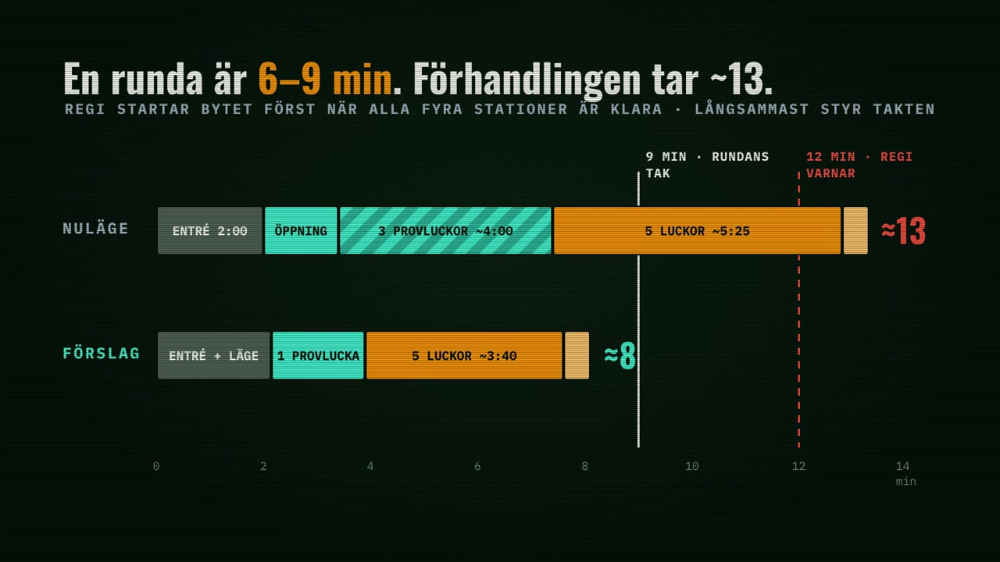
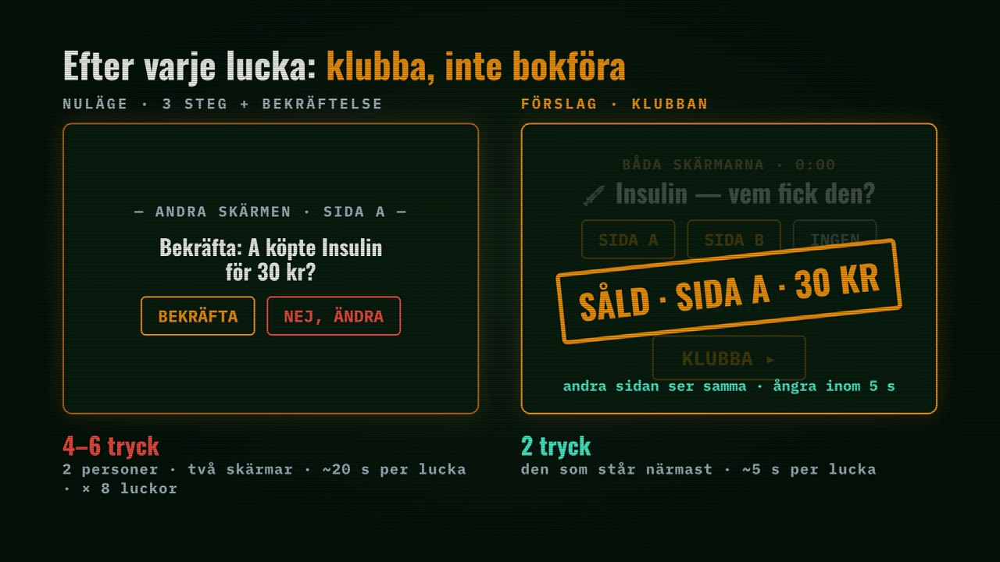
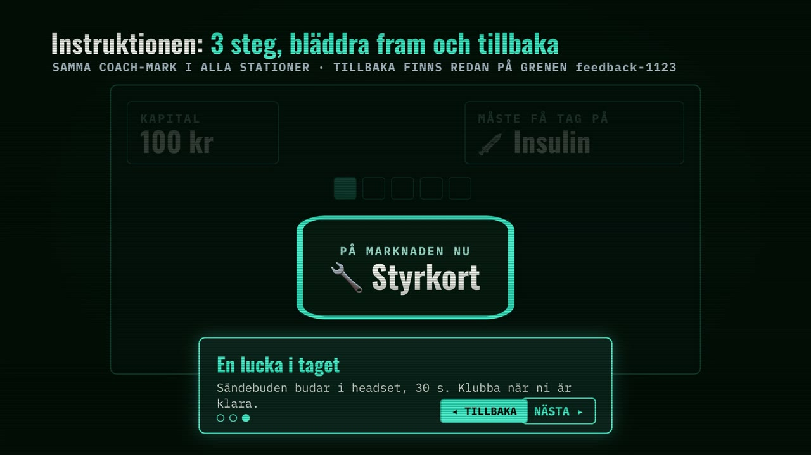

# Förhandlingen (st1): flödesanalys mot st2–st4 + förslag

> **2026-11-24 · ANALYS + FÖRSLAG.** Ingen kod är ändrad. Josef väljer vad som byggs.
> Underlag: `main` i `forhandlingen/` (7c420d6), `minnestest/`, `manniska-eller-maskin/`, `forhoret/`,
> `undersokningen/` och `stresstestet/` (läst 2026-11-24), XY-ROTATION, XY-FEEDBACK-LJUS-LJUD,
> XY-RESULTAT-OCH-VINST, XY-PLATSER och `xy-produktion/spellage/FORSLAG.md`.
> Tiderna är **uppskattningar** ur config/timers och klipplängder, inte mätta med en grupp.
>
> **Visuellt material (HyperFrames):** [`analys-2026-11/forhandlingen-nulage-forslag.mp4`](analys-2026-11/forhandlingen-nulage-forslag.mp4)
> (68 s, nuläge mot förslag), stillbilder i [`analys-2026-11/bilder/`](analys-2026-11/bilder/) och källan i
> [`analys-2026-11/storyboard/`](analys-2026-11/storyboard/) (redigerbar i HyperFrames desktop-app eller med `npx hyperframes preview`).

---

## 0. Kort sagt

1. **Förhandlingen tar cirka 13 minuter, men en runda är 6–9 minuter** (XY-ROTATION "Tider"). Regi startar bytet först när *alla fyra* stationer skickat `done`, så den långsammaste stationen styr takten. Efter 12 minuter varnar regi. Bara st4 Reaktorkärnan ryms i dag. St2 ligger på ~13–15 minuter, och dess egen översyn pågår.
2. **Tiden går inte åt till själva spelet.** Den går åt till *förberedelser och bokföring*:
   - en öppning med två dubbletter av entrén
   - en testomgång med **tre** provluckor plus en genomgång i fyra steg, cirka 4 minuter
   - **tre inmatningssteg plus en bekräftelse på andra skärmen efter varje lucka**, totalt 8 gånger
3. **Förhandlingen är den enda stationen med klickbara coach-marks över den riktiga konsolen.** Det är ett bra mönster, men där finns bara NÄSTA. TILLBAKA finns redan på den omergade grenen `feedback-1123` (47d13e7).
4. **3D:** entréns 3D-bilder (ankomst och "Så här blev det") fungerar som i st2 och st3. Däremot ligger **tre färdiga three.js-scener i `intro-3d/` som inte används**, medan tutorialen visar ett 19 s långt demoklipp med foton och animation.
5. **Ljus och ljud** är i bättre skick än XY-FEEDBACK-LJUS-LJUD §5.1 beskriver:
   - ljusspammet på ~20 msg/s är åtgärdat (`gameStore.ts:175`)
   - köp ger `ratt` på vinnarsidan (`gameStore.ts:216`)
   - gissningen ger `kvitto` (`GuessView.vue:41`)
   - avslutet har fem takter och en grön chase

   Ljus och ljud är alltså inte den stora bristen.

---

## 1. Förhandlingens flöde i dag

```mermaid
flowchart TD
  classDef entre fill:#4d5f58,color:#f5f5f0,stroke:#05100b
  classDef tut fill:#35e0d0,color:#05100b,stroke:#05100b
  classDef skarp fill:#ff9500,color:#05100b,stroke:#05100b
  classDef lek fill:#9b5cff,color:#fff,stroke:#05100b
  classDef dubb fill:#05100b,color:#ff5a3c,stroke:#ff5a3c,stroke-dasharray:4

  subgraph E["ENTRÉ (station-kit, delad) ~2:00"]
    A1["Ankomst: Ställ er på rätt sida<br/>3D-ankomst · 1 tryck/skärm"]:::entre --> A2["⏳ Väntar på andra sidan<br/>(ingen timeout)"]:::entre
    A2 --> A3["Hype-klipp 5,5 s"]:::entre --> A4["Brygga → kort A → Ida 25 s →<br/>brygga → kort B → Ossian 33 s"]:::entre
    A4 --> A5["Rollval person för person<br/>~3 × 1 tryck per sida"]:::entre --> A6["Så här blev det (3D)<br/>1 tryck/skärm"]:::entre
  end
  subgraph O["ÖPPNING (ljusblå) ~1:25 · 8 tryck/skärm"]
    O1["Titelskärm FÖRHANDLINGEN<br/>1 tryck"]:::dubb --> O2["Deltagarlista<br/>1 tryck"]:::dubb
    O2 --> O3["4 coach-marks över demo-konsolen<br/>bara NÄSTA · 4 tryck"]:::tut
    O3 --> O4["Demoklipp 'Så här kan en förhandling se ut'<br/>19 s · 1 tryck"]:::tut
    O4 --> O5["🎧 Ta på headsetet · BÖRJA<br/>⏳ väntar på andra sidan"]:::tut
  end
  subgraph T["TESTOMGÅNG (ljusblå) ~4:00 · ~25 tryck"]
    T1["2 coach-marks igen<br/>(samma text som nyss)"]:::dubb --> T2["⏳ Barriär"]:::tut
    T2 --> T3["3 provluckor × (gör er redo 5 s → budgivning 30 s →<br/>vem vann? → slutpris → BEKRÄFTA → andra sidan bekräftar)"]:::tut
    T3 --> T4["Gissning (ingen timer)"]:::tut --> T5["Genomgång i 4 steg<br/>4 tryck/skärm"]:::dubb
  end
  subgraph S["SKARPT (orange) ~5:25"]
    S0["3-2-1 NU KÖR VI PÅ RIKTIGT"]:::skarp --> S1["5 luckor × samma loop<br/>gör er redo 10/5 s · 30 s · 3 inmatningssteg + bekräfta"]:::skarp
    S1 --> S2["Gissning (ingen timer)"]:::skarp --> S3["Avslutet i fem takter<br/>SIDA A VANN! · auto 45 s"]:::skarp
  end
  L["LEK (lila): Vem där?<br/>tills regi byter"]:::lek
  A6 --> O1
  O5 --> T1
  T5 --> S0
  S3 -- done --> L
```

Röda streckade rutor är **dubbletter**, alltså steg som upprepar något gruppen redan sett.

**Källor:**
- `ForhandlingenApp.vue`: entré → onboarding → konsol → avslut → lek
- `onboarding/Onboarding.vue:1-24`: sekvensen
- `config.ts`: `ROUND_TIMERS`, `TRIAL_DATASET` (3 resurser), `DATASETS` (5)
- `components/BiddingZone.vue`: `getready → negotiating → entry_winner → entry_price → confirm`

**Var en grupp kan fastna:**
- **Redo-väntan i entrén och headset-grinden saknar timeout.** Om ena sidan inte trycker väntar den andra tills idle-reset efter 8 min.
- **Gissningen saknar timer.**
- **"Ingen köpte" kräver ett extra bekräftelsesteg** (det infördes efter ett feltryck i testomgång 1).
- Fastnar inmatningen räddar bara NEJ, ÄNDRA.

### 1.1 Tid och tryck, steg för steg (uppskattat)

| Del | Vad som tar tid | ≈ tid | ≈ tryck (båda skärmar) |
|---|---|---|---|
| Entré | 15 s redo + 5,5 s hype + ~65 s rollsekvens + ~20 s val + 15 s "Så här blev det" | 2:00 | ~10 |
| Öppning | titel, deltagare, 4 coach-marks, demoklipp 19 s, headset-grind | 1:25 | ~16 |
| Testomgång | 2 coach-marks + 3 provluckor à ~60 s + gissning + genomgång 4 steg | 4:00 | ~25 |
| Skarpt | 10 s + 5 luckor à ~60 s + gissning | 5:25 | ~25 |
| Avslut | fem takter, min 8 s, auto 45 s | 0:30 | 0–2 |
| **Totalt** | | **≈ 13:20** (11–14 beroende på KLAR-tryck) | **≈ 75** |

En lucka tar ungefär 5 s "gör er redo" + 30 s budgivning + ~20 s inmatning och bekräftelse. Spelet räknar med **8 luckor**: 3 i testet och 5 skarpa.

---

## 2. Stationerna sida vid sida

### 2.1 Flödet

| Steg | **st1 Förhandlingen** | **st2 Människotestet** (`minnestest`, i riggen nu) | **st3 Undersökningen** | **st4 Reaktorkärnan** |
|---|---|---|---|---|
| Ankomst | station-kit, 3D-ankomst, 1 tryck + redo-väntan | samma, 3D | samma, 3D | samma, men **2D** (ingen `illustrationUrl`) |
| Hype-klipp | 5,5 s | 5,5 s | 5,5 s | 5,5 s |
| Rollsekvens | ~65 s (Ida 25 + Ossian 33) | ~64 s | **~46 s** (19 + 15) | ~55–65 s |
| Rollval → "Så här blev det" | 1 tryck/person, 3D | 2 tryck/person, 3D | 1 tryck/person, 3D | 1 tryck/person, 2D |
| Förklaringen | titel + deltagare + **4 coach-marks (bara NÄSTA)** + demoklipp 19 s + headset-grind | titel + VALdi läser 4 rader (~30 s) | **VALdi-VO 111 s med 3D-film**, självrullande, plus rollgenomgång i 5–6 steg (bara NÄSTA) | **briefingfilm 52 s** |
| Övning (ljusblå) | 2 coach-marks + **3 provluckor** + gissning + genomgång i 4 steg, ~4 min | ett helt övningsrum, ~2:20 | ingen separat övning | **ett live-steg: KLAR tänds först när momentet är gjort** (~30 s) |
| Övergång | 3-2-1 | 5-4-3-2-1 "NU GÄLLER DET" | 3-2-1 | "REAKTORN GÅR VARM" 3-2-1 |
| Skarpt (orange) | 5 luckor à ~60 s + gissning utan timer, ~5:25 | 5 rum à ~2:20 (!) | timer 8:00 + 30 s frist | max 5:00 |
| Resultat | `station-kit/resultat`, fem takter, auto 45 s | samma | samma | egen `ResultScreen`, auto 45 s |
| Lek (lila) | "Vem där?" (röstmasken) | Fråga VALdi / Håll tråden | "Vad är det?" (mikroskopet) | Följ staven / Sänk pulsen |
| **Tryck före skarpt, per skärm** | **~20** | ~5 | ~9–10 | **~3–4** |
| **Total tid** | **≈ 13 min** | ≈ 13–15 min | ≈ 12–14 min | **≈ 6–9 min** |

> St2 får nya appar (Människa eller maskin ~4 min, Förhöret ~7 min). De saknar ännu rigg-sömmen helt: ingen entré, rotation, `done` eller lek (`forhoret/src/composables/useForhor.ts:756`). Se `minnestest/docs/st2-oversyn-koncept-2026-11-23.md`.

### 2.2 three.js

| | Ankomst-3D | "Så här blev det"-3D | Egen 3D i förklaringen | 3D i skarpt/lek |
|---|---|---|---|---|
| **st1** | ✅ `public/entre/` | ✅ figurer på `A/B.sandebud`, `A/B.rapportor` | ❌ **`intro-3d/` har tre färdiga scener** (`scen1-roller`, `scen2-marknad`, `scen3-ordvaxling`, 15 s-loopar, `tweenCamera`/`timeline`) **som inte är inkopplade**. Bara `lib.js` används, som källa till xy-entre-3d | ❌ |
| st2 | ✅ | ✅ | ❌ (Förhöret har en *beställning* på att porta st1:s `intro-3d/lib.js`) | ❌ |
| st3 | ✅ | ✅ | ✅ `introScene.ts` (905 rader), 3D-film som följer VALdis repliker beat för beat | ❌ |
| st4 | ❌ 2D | ❌ 2D | ❌ | ✅ `stavScene.ts` i gyrovyn och i leken |

Förhandlingen var först med 3D (stationsmodellen i xy-entre-3d kommer från `intro-3d/lib.js`), men har inte själv tagit 3D vidare in i förklaringen. Där använder den fortfarande foton och animation (`intro/NegotiateClip.vue` + `NegotiateDemo.vue`).

### 2.3 UI och instruktioner

| | Form | Nästa/Tillbaka | Röst | Textmängd |
|---|---|---|---|---|
| **st1** | **Coach-marks med spotlight över den riktiga konsolen** + `CoachAnim` (stämpel, pengar→poäng, ×2). Det enda i sitt slag. | NÄSTA. **TILLBAKA finns på `feedback-1123`** (CoachMark, StepShell, Onboarding, ResultWalkthrough) | nej (bara tutorial-bädd) | korta bubblor (~10–15 ord). Men `i18n/sv.ts` har **308 strängar, varav ~135 inte används** (gamla onboarding/narr/overview/login/test1/test3) |
| st2 | uppläsning med en framåtknapp. I de nya apparna slår korten ner i takt med VALdi | bara framåt | VALdi | ~60 ord intro, ~45 ord per scenario |
| st3 | självrullande VO + 3D, sedan rollgenomgång i en replika av konsolen med animerade tryck-prickar | bara NÄSTA | VALdi, 188 ord | 70–90 ord per roll |
| st4 | film + handlingen själv | ett steg | filmens röst | ~20 ord |

**Typografi och tema:** alla fyra kör CRT (`crt.css`, VT323 + IBM Plex Mono), blå `data-mode` i tutorial och bärnsten i skarpt. Bryggkort och spelläge använder Oswald + Plex Mono.

**Spellägeskortet** (`xy-produktion/spellage/FORSLAG.md`) är inte inbyggt någonstans. Förhandlingen är den station som **skapar** tävlingsreflexen ("sida mot sida"), som grupperna sedan tar med sig till st4 och st3 (rotation `[1,4,3,2]`).

**Sid-namnen är blandade:**
- entrén säger "Lag A/B"
- väntetexten säger "Väntar på sida A …"
- avslutet säger "SIDA A VANN!"
- koden säger lag1/lag2

XY-PLATSER säger *sida*.

### 2.4 Animationer och feedback

| | st1 | st2 | st3 | st4 |
|---|---|---|---|---|
| Skärmbyten | hårda (v-if) | ord tonar in | pop-övergångar, bryggkort | hårda |
| Nedräkningar | getready 10/5 s, budgivning 0:30, 3-2-1 | 5 s, talartimer | timer 8:00, ≤15 s andas, ≤5 s blink | runtimer, varning ≤15/≤5 |
| Rätt/fel | köp → `ratt` på vinnarsidan, `kvitto` vid gissning, `nobuy` | pling per person, mätarnål, valvdörr | bara kvitton (avsiktligt) | lockout med "Inte ditt fel" |
| Avslut | fem takter + grön chase | fem takter | fem takter, "DEN RIKTIGA TJUVEN VAR …" | egen |

Förhandlingens rörelse är tydligast **inuti** konsolen: kapitalet bultar, prickarna bultar, coach-anim. **Mellan** stegen är den svagast: tio olika helskärmar byts med hårda klipp, och ett köp har ingen "klubbslag"-takt där priset landar. Klubbslaget `xy-ljud/sfx/forhandlingen/d6-klubbslag.mp3` finns i ljudsatsen, men stationen använder det inte.

### 2.5 Komplexitet

| | Stationsegen kod (utan tester) | Regler besökaren måste förstå |
|---|---|---|
| **st1** | **~7 300 rader** | **~9:** 1 livsviktig, annars 0 · 2 pengar kvar = poäng · 3 gissa motståndarens = ×2 · 4 dölj din livsviktiga · 5 bud muntligt i headset · 6 sändebud pratar, rapportör tyst · 7 30 s per lucka · 8 en rapportör matar in vinnare och pris · 9 andra sidan bekräftar |
| st2 | ~5 000 | ~4 |
| st3 | ~6 500 | ~7 |
| st4 | ~4 700 | ~8 (men nästan alla lärs genom att göra) |

**Död och dubbel kod i st1** (kan tas bort utan att något ändras för besökaren):
- `BippStart` / stage `identify`. Den nås bara när `ROLLVAL_ENABLED=false`.
- `startTest1`, `TEST1_DATASET`, `SKIP_TEST1`.
- `RolesSplit`. Den hoppas över när rollvalet är på.
- `ResultWalkthrough mode="live"`. Den är inte inkopplad.
- `ROLE_FLOW_ENABLED`, `TEAM_PARTICIPANTS`/`checkedInParticipants` (pilotnamn) och väntläget `#vem` (`VemSaDet`).
- `reveal`-popupen med livsviktig-berättelsen (`critical.copy.*`). `revealSeconds: 0` överallt (`gameStore.ts:397-420`), så **berättelsen om varför resursen är livsviktig visas aldrig**.
- ~135 oanvända i18n-strängar.

Station-kit har dessutom glidit isär: 21 filer skiljer sig mot st4. CoachMark finns bara i st1 och st4, och `resultat/` saknas i st4.

---

## 3. Skillnader och brister (prioriterade)

| # | Brist | Var | Vad det kostar besökaren |
|---|---|---|---|
| B1 | **För lång:** ≈13 min mot rundans 6–9 | hela flödet | tre andra grupper står i lek och väntar. Regi varnar efter 12 min |
| B2 | **Testomgången är en hel minirunda**: 3 provluckor + gissning + genomgång i 4 steg | `Onboarding.vue` (test/testresult), `TRIAL_DATASET` | ~4 min av "inget räknas", med samma bokföring som skarpt |
| B3 | **Bokföring efter varje lucka**: vem vann → slutpris → BEKRÄFTA → andra sidan bekräftar | `BiddingZone.vue`, `gameEngine.ts` | ~40 tryck och ~2,5 min. Rapportören blir kassör i stället för spelare |
| B4 | **Dubbletter i öppningen**: titel (hype-klippet sa det), deltagare ("Så här blev det" visade det), 2 test-coach-marks (samma text), genomgång i 4 steg | `TitleScreen`, `ParticipantsScreen`, `testCoachSpecs`, `ResultWalkthrough mode=test` | ~10 tryck och ~1 min |
| B5 | **Bara NÄSTA** i coach-marks. Man kan inte gå tillbaka | `station-kit/components/CoachMark.vue` | den som missade "livsviktig" kan inte se det igen |
| B6 | **Spelläget sägs aldrig.** St1 *skapar* tävlingsreflexen, och ingen station tar ner den | (saknas), FORSLAG ②④ | grupper tror att st3/st4 också är tävling (Maddes test) |
| B7 | **Demoklippet förklarar med foton**, medan färdig 3D ligger oanvänd | `NegotiateClip.vue`, `intro-3d/` | 19 s som inte knyter an till entréns 3D-värld |
| B8 | **Väntan utan timeout**: redo, headset-grinden, barriären och gissningen | `entre.ts:291`, `Onboarding.vue` | en tyst sida låser hela stationen tills idle-reset efter 8 min |
| B9 | **Livsviktig-berättelsen visas aldrig** (`revealSeconds: 0`) | `gameStore.ts:397-420`, `sv.ts` `critical.copy.*` | "insulin" är bara ett ord. Varför det spelar roll faller bort |
| B10 | **Blandade namn**: Lag/Sida/lag1 | entré, i18n, avslut | liten förvirring om vilken sida man är |
| B11 | **Död kod och 135 oanvända strängar**, och station-kit har glidit isär | se 2.5 | ingen direkt kostnad för besökaren, men varje ändring blir långsammare och riskablare |

---

## 4. Åtgärdsförslag i prioritetsordning

Insats: **liten** < ½ dag · **medel** ½–2 dagar · **stor** > 2 dagar (inklusive test på bänk).

### F1 · En provlucka i stället för tre: "handlingen är spärren" · **medel** · −2,5 till −3 min
- Testomgången blir **en** lucka med **20 s** budgivning på den riktiga konsolen, i blått.
- Ingen gissning och ingen genomgång i fyra steg. I stället kommer en rad när luckan är klubbad: "Ni betalade 30 kr — i skarpt läge blir det som är kvar er poäng."
- Lånat från st4 (`stresstestet/.../Tutorial.vue:31-35`): KLAR tänds först när gruppen faktiskt har budat och klubbat en gång.
- `TRIAL_DATASET.ordning` får 1 resurs. `testresult`-stagen ersätts av en kvittens på ~4 s.
- **Ger besökaren:** man övar det som är svårt (att prata i headsetet och klubba) en gång, och kommer till det skarpa medan nyfikenheten finns kvar.

### F2 · "Klubban": en skärm per lucka · **medel** · −1,5 min, ~40 tryck färre
- När tiden är ute (eller vid KLAR) visar **båda** skärmarna samma ruta: `[SIDA A] [SIDA B] [INGEN]` + pris `− 30 kr +` + **KLUBBA ▸**.
- Den som står närmast trycker. Klubbslaget kommer i ljudet (`forhandlingen/d6`), stämpeln "SÅLD · SIDA A · 30 KR" visas på båda skärmarna och luckan blir sidans färg.
- Andra sidan har **ÅNGRA i 5 s** i stället för ett eget BEKRÄFTA-steg. Inget svar räknas som godkänt.
- Steget `confirm` och växlingen av `entryTeam` försvinner. "Ingen köpte" blir en vanlig knapp, och misstaget fångas av ÅNGRA.
- *Variant att pröva senare (stor, ändrar spelet):* "budmätaren". Varje rapportör håller sin sidas senaste bud på skärmen under budgivningen, och vid 0:00 vinner högsta budet automatiskt. Rapportören blir då aktiv hela tiden, men tvister kan uppstå. Testa med en grupp innan beslut.
- **Ger besökaren:** luckan slutar med en *takt*, ett klubbslag, i stället för ett formulär. Spelet känns som en auktion och inte som bokföring.

### F3 · Stryk dubbletterna i öppningen · **liten** · −1 min, ~10 tryck färre
- Ta bort `TitleScreen` (hype-klippet slutar redan på stationsnamnet) och `ParticipantsScreen` ("Så här blev det" visar redan vem som står var).
- Ta bort de två test-coach-markerna (samma text som nyss) och `ResultWalkthrough mode="test"` (ersätts av F1).
- Headset-grinden blir **steg 3 av coach-markerna** ("Sändebud: på med headsetet"). Den behöver inte vara en egen helskärm.
- **Ger besökaren:** från rollvalet till den första förklaringen på under 5 s.

### F4 · Tre coach-marks med TILLBAKA + 3D-luckan i stället för demoklippet · **medel**
- **Merga `feedback-1123`** (47d13e7). Den ger TILLBAKA i CoachMark och StepShell (`onboarding.back`). Samma gren finns i st4.
- Skär 4 coach-marks till **3**:
  1. livsviktig
  2. pengar = poäng (gissning ×2 som en rad)
  3. "en lucka i taget · headset · 30 s · klubba"

  Lägg stegprickar under.
- Ersätt `NegotiateClip` (foton + animation, 19 s) med **`intro-3d/scen3-ordvaxling`** eller **`scen2-marknad`**. De är redan byggda i three.js med samma stationsmodell som entrén. Lägg ~15 s VALdi-röst över, enligt st3:s mönster (`undersokningen/.../introvo/` + `bygg-vo.py`, VO och undertext ur en källa).
- Alternativ utan 3D-arbete: rendera scenen som ett HyperFrames-klipp och spela det som video.
- Visa livsviktig-berättelsen (`critical.copy.*`, B9) som undertext i coach-steg 1. Texten finns redan.
- **Ger besökaren:** kan bläddra tillbaka till det man missade. Förklaringen sker i samma 3D-värld som entrén och lärs ut med röst i stället för läsning.

### F5 · Spellägeskortet TÄVLING + påminnelsen i nedräkningen · **liten–medel** (görs gemensamt i station-kit)
- Gör ② och ④ i `xy-produktion/spellage/FORSLAG.md`:
  - kortet efter hype-klippet (~8 s, VALdi, synkat på båda skärmarna)
  - "NU GÄLLER DET · SIDA MOT SIDA" + symbolen i `ModeCountdown`
- St1 är stationen där tävlingen *börjar*. Därför ska kortet byggas här först och sedan återanvändas i st2–st4 med sina lägen.
- **Ger besökaren:** vet från början att det är sida mot sida, och nästa station kan ta ner det ("Nyss tävlade ni …").

### F6 · Timeouts på alla väntpunkter + timer på gissningen · **liten**
- Redo, headset-grinden och barriären får **auto-vidare efter 20 s** med en synlig nedräkning ("Vi börjar om 10 …").
- Gissningen får **20 s**, och ingen gissning räknas som fel (`kvitto` finns redan).
- Gör det i station-kit (`entre.ts`), så att st2 och st3 får samma skydd. Båda agenterna pekade ut samma brist där.
- **Ger besökaren:** en tyst sida kan inte låsa stationen.

### F7 · Ett namn: SIDA A / SIDA B · **liten**
- Byt "Lag A/B" i `ENTRE.sides` och `TEAMS` till "Sida A/B", enligt XY-PLATSER.
- Behåll lag1/lag2 i koden men aldrig på skärmen.
- **Ger besökaren:** samma ord från ankomsten till vinsten.

### F8 · Städa: död kod, oanvända strängar och station-kit · **medel**
- Ta bort det som listas i 2.5, alltså ~135 strängar och ~8 komponenter/flaggor.
- Bestäm vad som händer med `intro-3d/` (används i F4 eller arkiveras).
- Synka station-kit med st3/st4, i första hand `resultat`, `CoachMark` och `crt.css`.
- **Ger besökaren:** inget direkt. Ger Josef, Erik och Emil snabbare och säkrare ändringar.

### Effekt om F1–F3 + F6 byggs

| | Nu | Efter |
|---|---|---|
| Tid | ≈ 13 min | **≈ 8 min** (entré 2:10, tutorial 1:45, skarpt 3:40, avslut 0:30) |
| Tryck | ≈ 75 | **≈ 25–30** |
| Ryms i rundan (6–9 min) | nej | ja |

### Klipp (Josef är inte låst vid dem)

| Klipp | Förslag |
|---|---|
| Hype-klippet `forhandlingen.mp4` (5,5 s) | **behåll** |
| Rollklippen | Ossian 33 s är längst i hela riggen (st3: 19 + 15). **Korta till ≤ 20 s**, eller välj set 1 (Jakob 24 + Mary 17 = 41 s mot 58 s) |
| Demoklippet `NegotiateClip` (19 s, foton) | **ta bort** → 3D-luckan med VALdi (F4) |
| Nytt: spellägeskortet TÄVLING (~8 s) | **nytt** (F5) |
| Nytt: klubbslaget som stinger | **ny ~1 s takt** (stämpel + `d6`) vid varje köp (F2). Ljud, inget videoklipp |
| Tutorial-bädden `tutorial-loop.mp3` | behåll, men den blir kortare med F1/F3 |

---

## 5. HyperFrames-materialet

| Fil | Visar |
|---|---|
| [`analys-2026-11/forhandlingen-nulage-forslag.mp4`](analys-2026-11/forhandlingen-nulage-forslag.mp4) | 68 s med stationens egna sfx: tidslinjen, stegen, Klubban, coach-marks med TILLBAKA, spelläget och de fem förslagen |
| [`bilder/1-tidslinje.jpg`](analys-2026-11/bilder/1-tidslinje.jpg) | nuläge ≈13 mot förslag ≈8, med 9-minutersgränsen och 12-minutersvarningen |
| [`bilder/2-steg.jpg`](analys-2026-11/bilder/2-steg.jpg) | stegen efter entrén: vad som stryks och vad som ersätts |
| [`bilder/3-klubban.jpg`](analys-2026-11/bilder/3-klubban.jpg) | dagens inmatning (4–6 tryck) mot Klubban (2 tryck) |
| [`bilder/4-coach-tillbaka.jpg`](analys-2026-11/bilder/4-coach-tillbaka.jpg) | coach-mark med ◂ TILLBAKA / NÄSTA ▸ och stegprickar |
| [`bilder/5-spellage.jpg`](analys-2026-11/bilder/5-spellage.jpg) | spellägeskortet TÄVLING (symbolen från spellage/) |
| [`bilder/6-fem-forslag.jpg`](analys-2026-11/bilder/6-fem-forslag.jpg) | sammanfattningen |

Skärmarna i materialet är **skisser** i stationens CRT-språk, inte skärmdumpar av appen. Siffrorna är uppskattningar (se §1.1).
