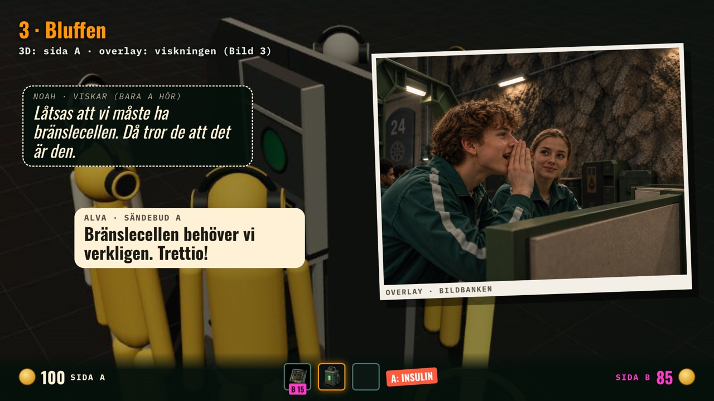
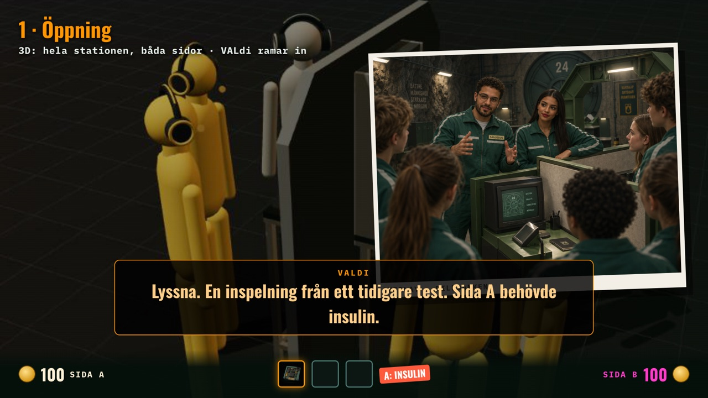

# Förhandlingen: exempelförhandlingen (förslag 2026-11-24)

> **FÖRSLAG, inget är byggt i appen.** Josef väljer först. Underlag:
> - [`exempelforhandling-2026-11/manus.json`](exempelforhandling-2026-11/manus.json): manuset som data
> - [`exempelforhandling-2026-11/bilder/`](exempelforhandling-2026-11/bilder/): storyboarden, sex rutor
> - källan i [`exempelforhandling-2026-11/illustration/`](exempelforhandling-2026-11/illustration/) (HyperFrames)

**Josefs mål:** att se *hur man tänker* när någon annan gör det. Det är viktigare än regeltexten, och mycket annat kan gå bort om detta finns med.

## 1. Så gör de andra stationerna

| Station | Visa hur det går till | Längd |
|---|---|---|
| **st2 Människa eller maskin** | `Exempel.vue`: en **förinspelad runda**. Fyra egna röster (ElevenLabs) spelar en runda medan skärmen visar den, och sedan dömer VALdi. Ramen är "en inspelning från ett tidigare test". Före den kommer en 3D-stationsfilm (vem gör vad). | ~60 s |
| st3 Undersökningen | VALdi-röst plus 3D-film som följer repliken beat för beat (`introScene.ts`) | 111 s |
| st4 Reaktorkärnan | briefingfilm, sedan ett live-steg där handlingen är spärren | 52 s + ~30 s |
| **st1 i dag** | bildregler, 3D-luckan, coach-mark och provluckan. **Ingen visar hur någon tänker.** | ~1:55 |

Människa eller maskins exempelrunda är förebilden: samma rollfördelning (röster per person, VALdi som ram) och samma längd.

## 2. Illustrationen: tre lager

**Josefs förslag:** 3D-scenen där kameran växlar till den som pratar, plus overlaybilder av verkliga personer med headset (infallet, viskningen, handgesten). **Jag håller med, med ett tillägg:**

| Lager | Vad det visar | Varför det behövs |
|---|---|---|
| **3D-scenen** (befintlig `lucka-3d`, kameran lutar mot den som pratar) | *Vem* som pratar och var den står. A och B på var sin sida om väggen. | Skillnaden mellan sidorna, och mellan sändebud och rapportör, syns i rummet. |
| **Overlaybilder ur bildbanken** (`public/assets/Bild 1–10`) | *Känslan*: viskningen bakom handen, eftertanken, lugnet, frustrationen. | 3D-gubbarna har inga ansikten. Människan bär bluffen. |
| **Tunt HUD** (luckorna, pris, A:s och B:s mynt, LIVSVIKTIG) | *Strategin i siffror*: B betalar 60 för fel vara, A tar insulinet för 10. | Utan siffror syns aldrig *att* bluffen lönade sig. Bara två saker är stora (pengarna och den livsviktiga), samma ordning som den renodlade skärmen. |

**Andra sätt jag övervägde:**

| Sätt | Varför jag avråder |
|---|---|
| **Bara skärmens eget språk** (exemplet spelas i konsolen, utan 3D) | Lär ut skärmen bäst, men visar inga människor. Det är *tänkandet* som ska fram. HUD-lagret tar med det bästa härifrån. |
| **En helt genererad film** | Generiska bilder ger fel stämning och svajande ansikten. Bildbanken har redan rätt personer, plats och ljus. |

**Krav på 3D-scenen:**
- **Sidfärger på gubbarna.** I dag har de rollfärger (gul och grå), så sida A och sida B ser likadana ut. Använd A varmvitt och B magenta, som i entrén och på underglow.
- **Tydlig talarmarkering.**
- **Kameran följer manusets repliker.** Scenens tidslinje finns redan (`talk('A'|'B')`) och behöver bara matas från `manus.json`.

### Bildbanken mot manuset

| Ögonblick | Bild | Passar |
|---|---|---|
| Öppning: gruppen vid konsolen | **Bild 1** | ✓ |
| Samrådet: sändebudet stämmer av med rapportören | **Bild 2** | ✓ samma par |
| Bluffen: viskningen bakom handen | **Bild 3** | ✓ handlingen, ⚠️ men ett annat, yngre par |
| B inser att de slösat | **Bild 9** (delad bild, en frustrerad person på ena sidan) | ✓ |
| Insulinet billigt: lugnet | **Bild 10** (även Bild 7) | ✓ samma par |
| Gissningen: rapportören resonerar | **Bild 8** (handen vid hakan, pekfingret upp) | ✓ samma par |

Mannen med glasögon och SÄNDEBUD-märket och kvinnan med headset återkommer i Bild 2, 4, 7, 8 och 10. De blir **sida A** (Adam, sändebud, och Noor, rapportör).

**Den enda luckan är Bild 3.** Den visar rätt handling men ett annat par. Två lösningar:
- **(a)** Låt bildparet vara sida B:s egna viskningar.
- **(b)** Gör en variant av Bild 3 med A-paret. Bildredigeringen *utgår då från banken* (Bild 2 och 3 som referenser), och ingen generisk bild genereras. Rekommenderas.

## 3. Manuset (v2, ~57 s)

| | Vem | Replik | Syfte |
|---|---|---|---|
| ram | VALdi | Lyssna. En inspelning från ett tidigare test. Sida A behövde insulin. | ramen, som i Människa eller maskin |
| **Lucka 1 · styrkort** | Ebba (B) / Adam (A) | Styrkortet? Vi ger tio. — Femton! Direkt. | så går en lucka |
| | Adam → Noor *(viskar)* | Behöver vi den? — Nej. Släpp den. | **sändebudet frågar rapportören** |
| | Adam | Ta det. → *klubba B 15* | |
| **Lucka 2 · bränslecell** | Noor *(viskar)* | Låtsas att vi måste ha bränslecellen. Då tror de att det är den. | **bluffen, rapportörens idé** |
| | Adam / Ebba | Bränslecellen behöver vi verkligen. Trettio! — Fyrtio. — Femtio! — Sextio. Den är vår. — Okej … ta den då. | B budar upp fel vara → *klubba B 60* |
| **Lucka 3 · insulin** | Noor *(viskar)* | Nu. Låtsas att du inte bryr dig. | |
| | Adam / Ebba | Insulin? Tja. Tio kronor. — Vi har nästan inga pengar kvar. Ta den. | **utdelningen** → *klubba A 10* |
| **Gissningen** | Noor | Vilken var deras? De tog styrkortet direkt, utan att tveka. Den var deras. | **rapportörens resonemang** → rätt, ×2 |
| | Ville (B) | Deras var bränslecellen. De ville ju ha den så mycket. | B blev lurad |
| ram | VALdi | Sändebudet pratar. Rapportören lyssnar och tänker. Dölj vad ni behöver, och hör vad de behöver. | sensmoralen |

**Varför så kort:**
- Tre luckor med **ett syfte var**: mekaniken, bluffen och utdelningen.
- Högst fem repliker per lucka.
- Inga regler förklaras med ord. Livsviktig, pengar kvar och ×2 *syns* i HUD och i utfallet.
- En enda strategisk idé, bluffen, plus rollskillnaden.
- 111 ord, ~51 s tal, ~57 s totalt. Det är kortare än Undersökningens intro och lika långt som Människa eller maskins exempel.

## 4. Vad som kan tas bort, och vad det innebär

| Ta bort | Sparar | Vad tar över | Risk |
|---|---|---|---|
| **Bildreglerna** (3 steg: Måste ha · Kvar = poäng · ×2) | ~25 s, 3 tryck | Exemplet visar alla tre, och skärmens påminnelser upprepar dem vid rätt lucka | liten |
| **3D-luckan** ("Så går en lucka") | ~15 s, 1 tryck | Exemplet är samma 3D-scen, fast med mening | ingen |
| **Coach-marken på luckväggen + VI ÄR REDO** | ~10 s | En enda kort ruta efter exemplet: "Er tur. Sändebud, headset på." + väntan på andra sidan | liten |
| **Provluckan** *(valfritt)* | ~55 s | Exemplet visar Klubban, och ÅNGRA rättar ett feltryck | den första riktiga klubban blir gruppens första. Rekommendation: **ta bort**, och behåll den som en flagga i config om testerna visar att den behövs |

**Instruktionen före skarpt:**
- I dag (efter ombyggnaden): spelläge 9 s + instruktion ~50 s + prov ~55 s ≈ **1:55**.
- Med exemplet: spelläge 9 s + exempel ~57 s + "er tur" ~5 s ≈ **1:10**. Med provluckan kvar blir det ≈ 2:05.

**Kod som går bort:**
- `BildRegler.vue`
- `Lucka3D.vue` (scenen återanvänds av exemplet)
- coach-mark-steget i `Onboarding.vue`
- `CoachAnim.vue`
- eventuellt `'prov'`-steget (motorn klarar fortfarande en provlucka via config)

**Detta finns kvar:** spellägeskortet, de renodlade påminnelserna, Klubban med ÅNGRA och väntan med auto-vidare.

## 5. Bygget, när Josef har valt

- **`Exempel.vue`:**
  - 3D-scenen (`lucka-3d`, med sidfärger) driven av `manus.json`
  - overlaykortet (bildbanken) som tonar in vid nyckelrepliken
  - HUD av befintliga `MarknadsVagg`, `MyntStapel` och `VaraBild`
  - synkat på båda skärmarna med samma epoch-mönster som spellägeskortet
  - ljud bara från ledaren
- **Röster:** ElevenLabs. VALdi plus Människa eller maskins tre röster, och en fjärde för Ville. **Kräver ditt OK** att använda ElevenLabs-nyckeln, eller att du kör `python3 -I exempelforhandling-2026-11/gen_vo.py` själv.
- **Insats:** medel–stor, cirka en till en och en halv dag inklusive test på bänk.

## 6. Frågor till Josef

| # | Fråga | Mitt förslag |
|---|---|---|
| 1 | Tre lager (3D, bildbanken, tunt HUD)? | ja |
| 2 | Bild 3: (a) B:s par eller (b) en variant med A-paret som utgår från banken? | (b) |
| 3 | Provluckan bort? | ja, men behåll som flagga |
| 4 | Namnen Adam och Noor (sida A, bildbankens par), Ebba och Ville (sida B)? | ok som utkast |
| 5 | Får rösterna genereras med ElevenLabs-nyckeln? | ja |
