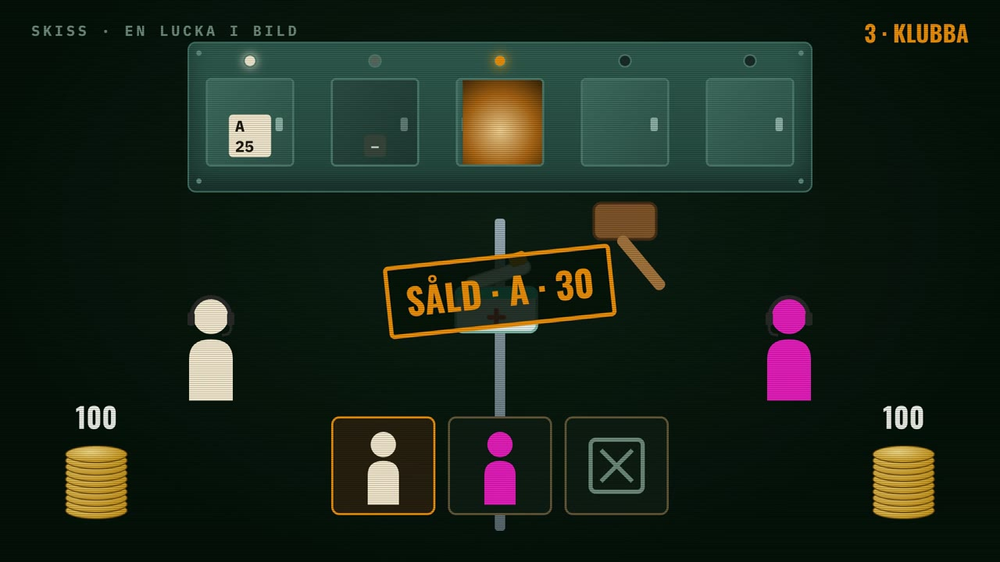
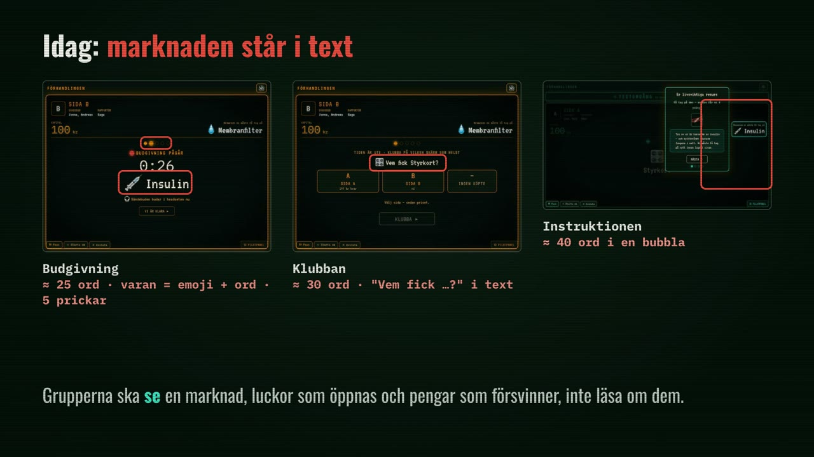
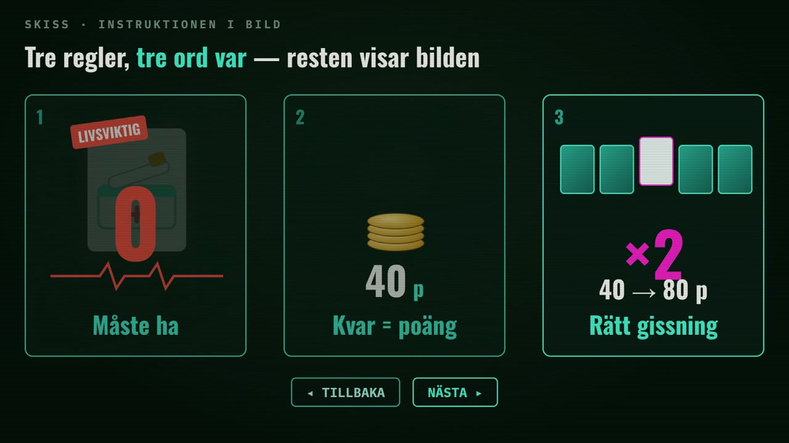

# Förhandlingen: från text till bild (utvärdering 2026-11-24)

> Josefs fråga: "så mycket är fortfarande textbaserat". Vad kan visas med bild och animation i stället,
> och behövs bildgenerering? Skisserna är gjorda i HyperFrames i stationens eget formspråk. De är inte stationsmedia.
>
> - **Film:** [`bildsattning-fran-text-till-bild.mp4`](bildsattning-fran-text-till-bild.mp4) (44 s, stationens ljud)
> - **Stillbilder:** [`bildsattning-2026-11/bilder/`](bildsattning-2026-11/bilder/)
> - **Källa:** [`bildsattning-2026-11/`](bildsattning-2026-11/)

## Läget idag

Efter flödesbygget (grenen `flode-2026-11`) är stegen färre, men **varje skärm bär fortfarande sitt budskap i text**:

| Skärm | Antal ord på skärmen |
|---|---|
| Budgivning | ≈ 25 |
| Klubban | ≈ 30 |
| Instruktionsbubbla | ≈ 40 |

Själva marknaden syns inte alls:
- Luckorna är fem små prickar.
- Varan är en emoji plus ett ord.
- Pengarna är en siffra.
- Den som tittar ser **CRT-paneler med ord**, inte en marknad.

## Förslaget: marknaden som bild

**1. Luckväggen ersätter prickarna.**
- Fem stålluckor i rad, samma vägg som de fysiska luckorna på stationen.
- Lampan över varje lucka visar läget:
  - släckt = kommande
  - bärnsten = öppen nu
  - varmvit = sida A tog den
  - magenta = sida B tog den
  - grå = ingen köpte
- Samma färger som underglow, så skärmen och rummet säger samma sak.

**2. Varan kommer ut ur luckan.**
- Luckan svänger upp och den illustrerade varan glider fram.
- Ordet blir en etikett, inte huvudsaken.

**3. Budgivningen i bild.**
- En ring runt varan är tiden.
- Buden syns som pratbubblor från A-sidans och B-sidans figur, över mellanväggen.
- Rapportören kan trycka in budet som en bubbla, eller så visar bubblorna bara att det pratas.
- Texten "BUDGIVNING PÅGÅR" försvinner.

**4. Klubban i bild.**
- Tre bildknappar: A-figur, B-figur och tom lucka.
- Priset som mynt.
- Klubbslaget och stämpeln finns redan i ljudet och i stämpeln i appen.
- Mynten flyger från sidans hög in i luckan, och luckan stängs med sidans färg.

**5. Pengarna som myntstapel.**
- 1 mynt = 10 kr. Stapeln krymper vid varje köp.
- I avslutet räknas mynten om till poäng.

**6. Instruktionen som tre bildregler med tre ord var.**
1. "Måste ha": varukortet med LIVSVIKTIG-tagg och puls, annars 0.
2. "Kvar = poäng": mynt försvinner och resten blir poäng.
3. "Rätt gissning": ett kort vänds och ×2 visas.

NÄSTA och TILLBAKA finns kvar.

**7. Väntan och gissningen.**
- Väntan visar andra sidans figur och en ring i stället för "Väntar på sida B …".
- Gissningen blir fem varukort som vänds.

## Behövs bildgenerering?

**Nästan allt går att rita** i appen (SVG/CSS, som i skisserna): väggen, lamporna, figurerna, mynten, ringen och klubban. Bildgenerering behövs till två saker:

| Vad | Antal | Varför |
|---|---|---|
| **Varorna** | 5: insulin, bränslecell, styrkort, radiosändare, membranfilter | Samma stil som attract-bilden (stiliserad 3D, teal stål, bärnsten). Bilderna återanvänds i luckan, i livsviktig-kortet, i gissningen och i avslutet. |
| **Miljöbild bakom luckväggen** | 1 | Bergrum med luckväggen, svagt bakom UI:t, så att skärmen känns som en plats och inte som en monitor |

**Prov är inte gjorda än:**
- HyperFrames egen bildgenerering (HeyGen) kräver ett HyperFrames Pro-abonnemang.
- Projektets egen väg (`xy-bildgen`, gpt-image med attract-bilden som stilreferens) stoppades av behörighetsspärren, eftersom den läser API-nyckeln i ett annat projekts `.env`.
- Promptarna och stilreferensen ligger klara för fyra prov (miljö + insulin + bränslecell + styrkort).

## Rekommendation

1. **Bygg luckväggen, Klubban i bild, myntstapeln och bildreglerna ritat i appen nu.** Det tar bort det mesta av texten och kräver ingen bildgenerering.
2. **Ta fram fyra bildprov för varorna och miljön.** Josef väljer stil, och sedan genereras hela setet (5 varor + 1 miljö).
